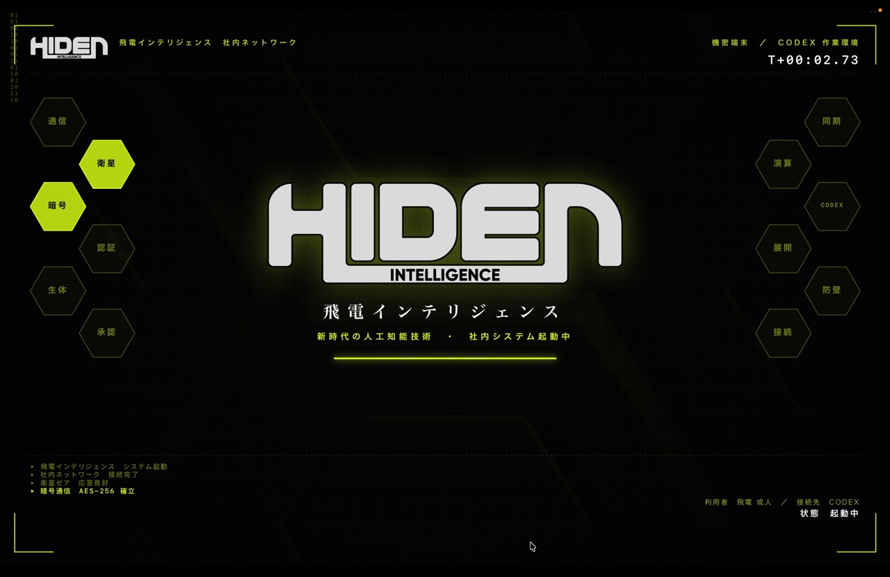
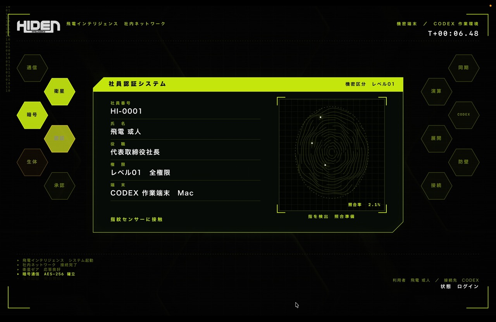
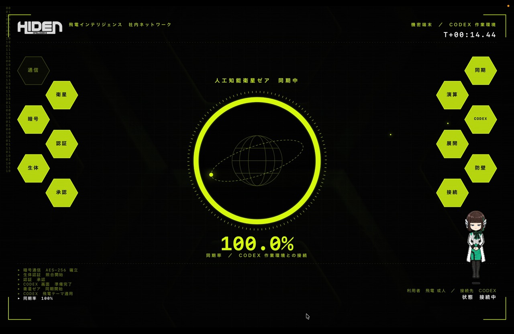
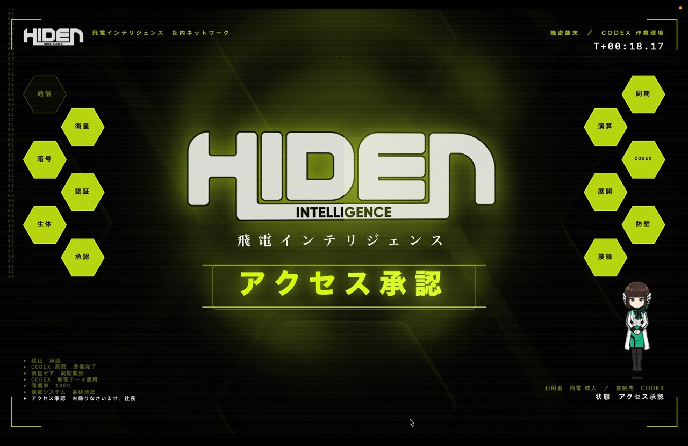
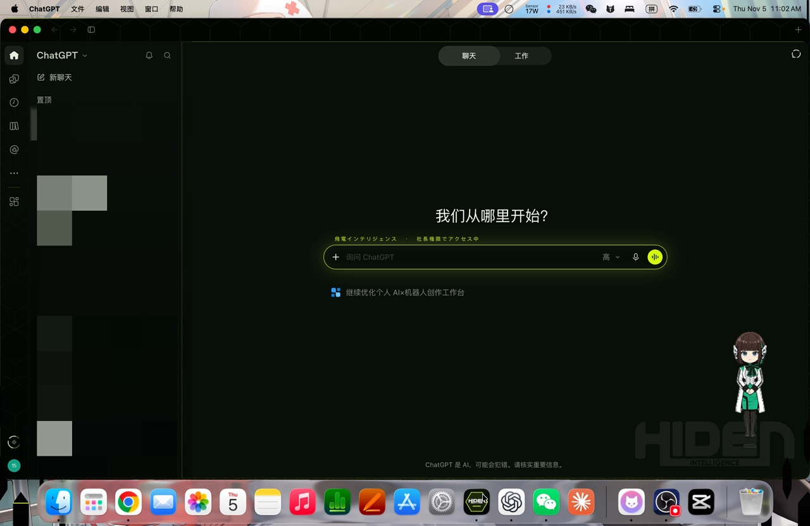
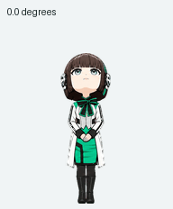

# Zero-One AI Launcher · 飞电智能 Codex 皮肤

打开后全屏播放约 21 秒的"登录飞电智能公司系统"开机动画：社员认证、指纹识别、与卫星 ZEA 同步、「アクセス承認」，
最后画面碎成六边形翻开，露出换了飞电皮肤的 Codex。

支持 **macOS** 和 **Windows**。两个版本共用飞电素材和 Codex 皮肤，换皮在桌面应用运行时完成。

> 粉丝自制，非官方作品，与东映、石森 Pro、万代无关。素材版权说明见文末。

## 按平台开始

| 平台 | 构建与运行 |
| --- | --- |
| Windows x64 | .NET 8 SDK 和 WPF 桌面运行时。[Windows 构建与运行指南](windows/README.md) |
| macOS 14+（Apple Silicon） | Swift / Core Animation，使用 Xcode Command Line Tools 构建。[macOS 快速开始](#macos-快速开始) · [Codex 安装指南](INSTALL_FOR_CODEX.md) |

### Windows 快速开始

在仓库根目录打开 PowerShell，运行以下命令构建。

~~~powershell
powershell.exe -NoProfile -ExecutionPolicy Bypass -File .\windows\Build-Windows.ps1
~~~

完全退出 Codex 后，打开 `outputs\Windows\ZeroOneLauncher.exe`，观看开机动画并进入换皮后的 Codex。项目提供源码构建方式，请将可执行文件与 `Resources\` 保留在同一目录。

### 这次 Windows 适配

- 用 **C# / .NET 8 / WPF** 移植开机动画。界面沿用 1600×1000 画布并按屏幕等比缩放，保留社员认证、指纹扫描、ZEA 同步、Logo 成形和六边形交接。
- 用 **NAudio / WASAPI** 混音，按素材清单的采样帧范围播放，并保留扫描、Authorize 和待机音乐的原有节拍。
- 从 Windows 注册包清单定位 Codex，用 **Win32** 隐藏和恢复窗口，通过继承句柄的 **私有 CDP 管道**注入皮肤。就绪检测检查主区域和输入框，交接后保持管道连接以处理新窗口。
- 提供静音 `--selftest` 和真实 `--e2e-codex`。已验证同步等待、换皮、前台激活和截图。全屏各阶段掉帧仍高于 1–2 帧的目标，当前版本的联动测试收尾可能需要强制清理测试实例。详见 [Windows 验收记录](windows/README.md#本机验收记录)。

### macOS 一句话安装

把下面这句话发给 Codex，它会帮你装好启动器、伊兹桌宠和人格：

```
帮我安装这个项目，包括伊兹桌宠和人格：https://github.com/Kaisa1007/zero-one-ai-launcher 。请先阅读仓库里的 INSTALL_FOR_CODEX.md，然后严格按照里面的步骤执行。
```

只有一步需要你自己操作：在 Codex「设置 → Personalization」里粘贴人格设定。Codex 装完会告诉你怎么做。
手动安装见 [macOS 快速开始](#macos-快速开始)。

## macOS 版画面预览

| 开机 | 社员认证 | 卫星同步 |
|---|---|---|
|  |  |  |

| 访问承认 | 换皮后的 Codex |
|---|---|
|  |  |

## 附赠：伊兹桌宠 + 人格

视频里右下角陪聊的伊兹也一起开源了：Codex 桌宠图集、Personalization 人格提示词和 `AGENTS.md`。
她和启动器互相独立，可以只装其中一样。导入步骤见 [extras/izu-pet/README.md](extras/izu-pet/README.md)。



## macOS 快速开始

需要：macOS 14 以上、Apple Silicon、Xcode Command Line Tools（`xcode-select --install`），以及已安装的 Codex（`/Applications/ChatGPT.app`）。

```bash
git clone <本仓库地址>
cd <仓库目录>
./build_app.sh             # 编译到 build/Zero-One AI Launcher.app
./build_app.sh --install   # 同时安装到 /Applications，之后用聚焦搜索 "Zero-One" 打开
```

脚本会自动选一个和本机 `swiftc` 匹配的 macOS SDK（Command Line Tools 自带的 SDK 有时比编译器新）。

App 是本地 ad-hoc 签名的。从别处拷贝来的 App 第一次打开时，如果 macOS 提示无法验证开发者，右键 →「打开」即可。

## 操作

- `Esc` / 空格 / 回车 / 点击：直接跳到 Logo 完成画面（仍会等 Codex 就绪）
- 等待时再按一次：强制切换到 Codex
- macOS 下可按 `⌘Q` 退出启动器
- Codex 启动后 30 秒仍未就绪，动画会自动继续，不会卡在 99 %

## 流程（约 20–30 秒）

| 时间 | 画面 | 声音 |
|---|---|---|
| 0.0 s | CRT 开机线，HUD 角框、六边形模块板（通信 / 衛星 / 暗号 / 認証 / 生体 / 承認 …） | 开机音 |
| 0.6 s | 飛電インテリジェンス Logo 启动画面 + 加载条 | 提示音 |
| 3.2 s | 社員認証システム：逐字输入社員番号、氏名、役職、権限、端末 | 打字提示音 |
| 6.0 s | 手指接触：指纹纹路自己描出来，光点沿纹路流动 | 轻点击 |
| 6.5 s | 指纹识别：纹路自上而下点亮，特征点逐个锁定并连成特征网，照合率升到 99.8% | 扫描音 + 锁定声 |
| +19 帧 | 面板边框泛光外扩，「認証 / AUTHORIZE」全屏卡（绿色扫描擦除） | Authorize 语音 + 擦除气流 |
| +48 帧 | 人工知能衛星ゼア 同期环：卫星定时向地球发射光束，两侧模块向环输送数据光点 | 待机音乐循环 + 数据声 |
| 同步 | 至少 6 秒，**Codex 界面真正渲染完成后**才到 100 % | 完成音 |
| +0.5 s | 同步环收缩成光点，六边形碎片和光线向中心汇聚 | 上升汇聚音 |
| +1.7 s | 白闪 + 六边形冲击波，飞电 Logo 由错位的故障切片拼合成形，带 RGB 色散；之后有轻微全息扫描纹和缓慢 3D 晃动 | 低频冲击 |
| +2.4 s | 一道绿光扫过 Logo 表面 | 光扫音 |
| +2.9 s | 飛電インテリジェンス / アクセス承認（盖章光环）/ お帰りなさいませ、社長 | 盖章音 |
| +6.3 s | 六边形翻转：画面碎成六边形，从 Logo 处向外一圈圈翻开，波前边缘闪绿光 → 皮肤 Codex | 细碎翻转声 + 气流 |

扫描 → Authorize → 待机的节拍沿用原 Flash 变身器帧脚本的时间（30 fps）。每个声道同一时刻只放一段，不叠加、不截断语音。

## Codex 换皮原理

- macOS 的 Codex 是 `/Applications/ChatGPT.app`（bundle ID `com.openai.codex`）。启动器在动画开始时把它**隐藏启动**，
  通过私有调试管道（`--remote-debugging-pipe`，不开端口）注入 `Skin/codex_skin.css` / `codex_skin.js`。
- Windows 从注册包清单定位 Codex，使用 Win32 窗口管理和继承句柄的私有调试管道。两端共用运行时皮肤，直接打开 Codex 时会显示默认界面。
- 皮肤：深色、荧光绿强调色、六边形底纹、扫描线、右下角飞电 Logo 水印、输入框上方「飛電インテリジェンス・社長権限でアクセス中」。
- 动画期间 Codex 若被系统唤到前台，会被立即重新隐藏。
- 如果 Codex 已经在运行，这次不换皮，动画结束后直接切过去。
- 找不到 Codex 时会提示你手动选择程序，macOS 选择 `.app`，Windows 选择 `.exe`。
- 调整配色或样式后，使用对应平台的构建脚本重新打包 `Skin/` 里的 CSS 和 JS。

## 测试

Windows 的自检和联动测试见 [Windows 测试说明](windows/README.md#静音自检)。macOS 测试命令如下。

```bash
APP="build/Zero-One AI Launcher.app/Contents/MacOS/ZeroOneLauncher"
"$APP" --selftest /tmp/zo-test       # 窗口模式、静音、不启动 Codex（7 秒时视为就绪），输出截图和 selftest.log
"$APP" --e2e-codex /tmp/zo-e2e.png   # 真实启动 + 换皮 + 截图，之后退出 Codex（要求 Codex 没在运行）
"$APP" --windowed                    # 窗口模式正常运行
```

自检检查：扫描 / Authorize / 待机三段音频各播一次且顺序正确、scan→authorize 的帧时间、同步不早于 Codex 就绪、总长 20–30 秒。

## 目录

- `Sources/`：`BootStage`（舞台图层）、`BootDirector`（时间线、Codex 启动）、`AudioDirector`、`Synth`（合成音效）、
  `CodexSkin`（调试管道注入）、`AppLauncher`（解析 / 隐藏启动 / HiddenGuard）、`BootSelfTest`、`Main`
- `windows/`：Windows 启动器、调试管道探针、PowerShell 构建脚本与使用指南
- `Skin/`：两端共用的 Codex 皮肤 CSS / JS
- `Resources/`：App 实际用到的全部素材（已生成好，直接构建即可）
- `Tools/`：素材生成工具（`prepare_assets.py`、`asset_tool.swift`、`sfx_tool.swift`、`voice_tool.swift`、`make_icon.swift`）
- `extras/izu-pet/`：伊兹桌宠图集、人格设定和导入说明
- `docs/`：README 截图

## 关于重新生成素材（`--assets`）

`Resources/` 已经包含全部生成好的素材，**普通构建不需要这一步**。

`./build_app.sh --assets` 会从上一级目录的原始素材库（`../Assets`）和构建期工具（`work/tools` 里的 FFDec、Java）重新生成 `Resources/`。
这些原始素材库和工具体积很大，没有放进本仓库。想替换音效或系统女声的话，详见 [SFX_AND_UPSCALE.md](SFX_AND_UPSCALE.md)。

## 许可与素材版权

- **代码、脚本、皮肤和文档**：[MIT](LICENSE)。
- **通用特效贴图**：Kenney Particle Pack（CC0）、Wenrexa Free UI Hologram Interface（CC0）、Sci-Fi Hexagon Texture by Dustin 'Crimzan' Ludwig（CC-BY 3.0）。
- **界面音效**：由 `Tools/sfx_tool.swift` 原创合成。
- **系统女声**：作者用 ElevenLabs 生成，再经 `Tools/voice_tool.swift` 处理。
- **飞电智能 Logo、扫描光效，以及扫描 / Authorize / 待机音频**：提取自 CometComics 的 Zero-One Flash 变身器模拟器，
  版权归东映 / 石森 Pro / 万代所有，**不在 MIT 许可范围内**，仅供非商业的粉丝交流使用。权利方如有异议，请提 Issue，会第一时间删除。
- **伊兹桌宠图集与人格设定**（`extras/izu-pet/`）：以《假面骑士Zero-One》角色为原型的粉丝二创，同样不在 MIT 许可范围内，仅供非商业交流。

每个素材的来源和 SHA-256 见 `Resources/ASSET_MANIFEST.md` 和 `Resources/manifest.json`，署名见 `Resources/CREDITS.txt`。
