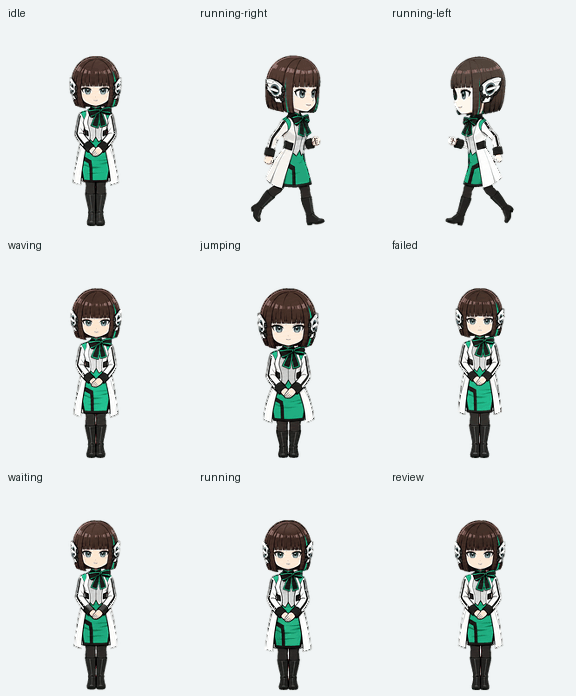

# 伊兹 · Codex 桌宠 + 人格包

视频里右下角陪聊的伊兹。她和启动器是分开的两样东西：启动器负责开机动画和换皮，伊兹是 Codex 自带的 Pets（桌宠）功能加上一套人格设定。不装启动器也能单独用她。



## 文件说明

| 文件 | 是什么 | 放到哪里 |
|---|---|---|
| `spritesheet-extended.png` | 桌宠动画图集（v2，1536×2288，9 组动作 + 16 个视线方向） | 在 Codex 里导入，见下文 |
| `PERSONALIZATION.md` | 完整人格提示词：性格、说话方式、行为规则、禁止事项 | Codex「设置 → Personalization」 |
| `AGENTS.md` | 精简版人格 + 工作汇报格式 + **边界规则**（代码、注释、commit 里不用角色语气） | `~/.codex/AGENTS.md` |
| `all-states.gif` / `look-loop.gif` / `motion-stills.png` | 预览图，不用导入 | — |

图集 SHA-256：`b60d48367c37fddd7c186b497a98ef0eaf8b1d9626bc4b68c02c14d57323064d`，和作者在用的是同一份。

## 第一步：导入桌宠

需要 Codex 能用 ChatGPT Work 模式和 Pets 插件。

1. 下载 `spritesheet-extended.png`，放在任意位置，比如「下载」文件夹。
2. 在 Codex 里新开一个对话，发送：
   ```
   用这张图集创建一个宠物并设为当前宠物：<图集的完整路径>
   名字：伊兹
   描述：以《假面骑士01》伊兹为原型的Q版修玛吉亚秘书，认真礼貌地辅助工作，也在陪伴中学习情感。
   ```
3. Codex 会先检查图集，再上传到你自己的账号，然后启用。上传时 Pets 服务会做图片审核，通常一次就能通过。

不需要重新生成图片，形象和动作都和视频里一模一样。

## 第二步：设置人格

两处都要设置，作用不同：

**1. Personalization（说话的性格）**

打开 Codex「设置 → Personalization」：
- 人格 / Personality 预设选 **None**，否则内置人格会和伊兹的设定冲突；
- 把 `PERSONALIZATION.md` 从「一、核心身份」到末尾的内容，粘贴进自定义指令一栏；
- 「怎么称呼你」一栏填 **社长**。

**2. AGENTS.md（工作时的规矩）**

把 `AGENTS.md` 复制到 `~/.codex/AGENTS.md`。如果你已经有这个文件，就把内容追加到末尾，不要覆盖：

```bash
cat AGENTS.md >> ~/.codex/AGENTS.md
```

它最重要的作用是**边界规则**：角色语气只出现在和你对话的文字里，代码、注释、commit message 和文档都保持正常专业风格。

设置完成后，新开的对话才会生效。

## 备注

- **为什么人格要放两处**：Personalization 定义她「是谁、怎么说话」，在 ChatGPT 和 Codex 里都生效；`AGENTS.md` 是 Codex 写代码时读取的规则，保证角色扮演不会把「社长」写进你的代码。两份内容有少量重叠，这是有意的。
- **想改称呼**：把两个文件里的「社长」换成你想要的称呼，再把 Personalization 里的昵称改掉即可。
- **不想要桌宠，只要人格**：跳过第一步就行，反过来也一样。
- **图集是怎么做的**：用 Codex 的 Pets 插件（create-pet）配合内置图片生成制作，服装和配色参考了东映官方的角色资料。
- **版权**：伊兹是《假面骑士Zero-One》（东映 / 石森 Pro）的角色。这里的桌宠图集和人格设定是粉丝二创，仅供非商业交流使用，不在本仓库的 MIT 许可范围内。
